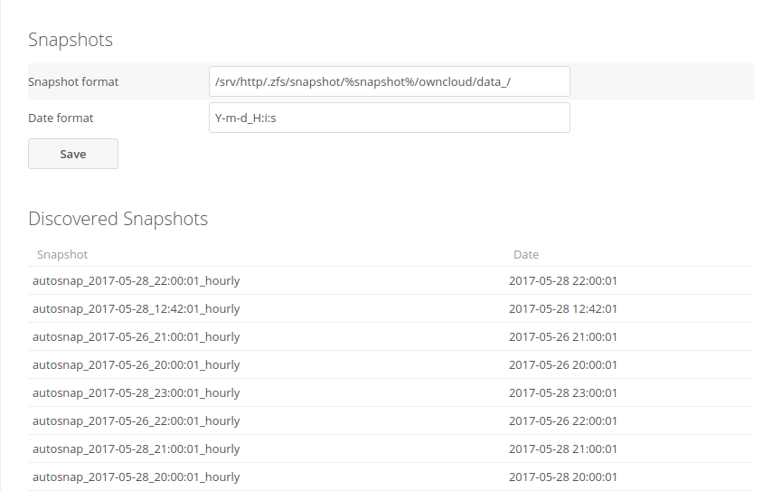

# files_snapshots

Access filesystem snapshots from Nextcloud.



Allows using filesystem snapshots (such as provided by zfs, btrfs, NAS systems or backup tools) as versions of files,
instead of the builtin Nextcloud versions.

Snapshots are used for the Nextcloud data directory (home folders and group folders), "Local" external storages and
any other folder on disk you configure. Storages without snapshots keep using the regular Nextcloud versions.

## Limitations

This app does not automatically create snapshots itself, because of this it might not have a snapshot
for every change made to the file.

Since no snapshots are created by the app, when reverting a file, any change made to a file since the last snapshot will be lost.

Only snapshots in which a file was changed are shown as a version, and versions are only available for files, not folders.

Group folders with encryption enabled can't use snapshots, since their files are encrypted on disk.

Files are only read from inside a snapshot: symlinks in a snapshot that point outside of it are ignored, like the local
storage of Nextcloud does for the live files.

## Requirements

- The "Versions" app (`files_versions`) needs to be enabled, snapshots are shown in the versions tab of a file.
- The snapshots need to be readable by the web server user, as regular folders on the local filesystem.

## Configuring

All settings are under "Snapshots" in the admin settings. The "Discovered snapshots" overview at the bottom shows where
snapshots are found for the data directory, every local external storage and every additional location,
using the settings on the page, before they are saved.

### Data directory

- **Snapshot format**: where the snapshots of the Nextcloud data directory can be found

  example: `/srv/http/.zfs/snapshot/%snapshot%/nextcloud/data/`  
  where `/srv/http/nextcloud/data` is the Nextcloud data directory  
  and `/srv/http` is a folder which is being snapshoted to `/srv/http/.zfs/snapshot`.

  Additionally, if your snapshots are organized over multiple directories like

  ```
  /.snapshots/hourly/2020-02-07_00:00/...
  /.snapshots/hourly/2020-02-07_01:00/...
  /.snapshots/daily/2020-02-06_00:00/...
  /.snapshots/daily/2020-02-07_00:00/...
  ```

  you can use a glob such as `/.snapshots/*/%snapshot%/` to make the app search for snapshots in multiple directories.

  This can be left empty when the data directory is found by the automatic detection below.

- **Date format**: how the snapshot date is formatted in the snapshot name, used for all snapshot locations.

  Specifications about the format: https://www.php.net/manual/en/datetime.createfromformat.php

  Example: `*Y-m-d_H:i:s*` will correctly match snapshots named `autosnap_2017-05-27_00:00:01_hourly`

  Hint: Each * will only match until the next separator or digit

  Example: `*-*-*-Y-m-d-Hi` will correctly match snapshots named `zfs-auto-snap_frequent-2017-06-23-1930`

  Characters that have a meaning in the format (letters, `+`, `*`, `?`, ...) need to be escaped with a `\`
  to match literally, e.g. `\G\M\T\+01_Y-m-d_Hi` for `GMT+01_2024-07-26_0755`.

  If the format doesn't match a snapshot name, common date formats in the name are detected automatically,
  such as `2026-11-15-1350`, `2026-11-15_13:50:00`, `20261115T1350` or `20261115-135000`.
  For snapper, the date is read from its `info.xml`.
  Otherwise, the modification time of the snapshot directory is used.

### Additional snapshot locations

Map a folder on disk to the location of its snapshots, for folders outside the data directory such as local
external storages, or when the snapshots of a folder are stored elsewhere.

| Folder on disk               | Snapshot format                                    |
|------------------------------|----------------------------------------------------|
| `/mnt/photos`                | `/mnt/photos/.zfs/snapshot/%snapshot%`             |
| `/mnt/media/video`           | `/mnt/systemvol/snapshots/video/%snapshot%`        |
| `/srv/nextcloud/data/%user%` | `/srv/backups/%user%/%snapshot%`                   |

`%user%` matches any single folder name, and is replaced by that name in the snapshot format.
This allows one entry for backups that are stored per user, like `/srv/backups/<user>/daily.0`.

When multiple locations match a file, the one with the longest folder is used.

### Automatically detect snapshot directories

For local storages that don't match a configured location, look for a snapshot directory in the folder of each file
and its parent folders, the nearest one is used. This works for any number of datasets or volumes without further
configuration.

The snapshot directories are configured as patterns relative to the folder being checked, by default:

| Pattern                          | Used by                                  |
|----------------------------------|------------------------------------------|
| `.zfs/snapshot/%snapshot%`       | ZFS (also with `snapdir=hidden`)         |
| `.snapshots/%snapshot%/snapshot` | btrfs with snapper                       |
| `.snapshot/%snapshot%`           | NetApp and other NAS systems             |
| `.snap/%snapshot%`               | CephFS                                   |

Other layouts can be added, for example `#snapshot/%snapshot%` for Synology or `@Recently-Snapshot/%snapshot%` for QNAP.

Users can create folders with these names through Nextcloud, so a detected snapshot directory is only used when its
snapshots are separate filesystems (a different device than the folder they belong to), like zfs snapshots and btrfs
subvolumes. Folders created through Nextcloud never are, so they can't be used to make other files show up as versions.
Every snapshot in a detected directory is checked, and symlinks are not followed.
If your snapshots are not detected because of this, configure them as an additional snapshot location instead,
those are not checked.

### Test a path

Shows where the snapshots for a file or folder on disk are found with the current settings,
and how many versions a file has.

## Setup examples

### Docker

The snapshots need to be visible inside the container, at the paths used in the settings.

- If the data directory (or external storage folder) is the root of a zfs dataset, mounting the dataset
  into the container is enough, the `.zfs` directory is available in the container as well.
  Automatic detection will find it.

  ```yaml
  volumes:
    - /tank/nextcloud-data:/var/www/html/data
  ```

- If it is a folder inside a dataset, the `.zfs` directory of the dataset is not visible from the folder.
  Mount the dataset root (or a parent folder of it) into the container as well, and configure where the snapshots are:

  ```yaml
  volumes:
    - /tank/containers/nextcloud_data:/var/www/html/data
    - /tank/containers:/tank/containers:ro
  ```

  with the snapshot format `/tank/containers/.zfs/snapshot/%snapshot%/nextcloud_data`.
  ZFS mounts snapshots when they are accessed, mounting the dataset root works more reliably
  than mounting the `.zfs/snapshot` directory itself.

Use "Test a path" with a path as seen from inside the container to check the result.

### TrueNAS

TrueNAS periodic snapshot tasks name snapshots like `auto-2026-10-15_23-10`, the date is detected automatically.

Snapshots of a dataset are in the `.zfs/snapshot` directory at the root of the dataset. When Nextcloud runs as an app,
the dataset containing the data needs to be mounted as host path (see "Docker" above), and the snapshots are
then found by the automatic detection, or with a snapshot format like `/var/www/html/data/.zfs/snapshot/%snapshot%`.

### QNAP

QNAP stores snapshots of a shared folder in `@Recently-Snapshot` at the root of the share, named like
`GMT+01_2024-07-26_0755`. Add `@Recently-Snapshot/%snapshot%` to the automatic detection patterns, or use a snapshot
format like `/var/www/html/data/@Recently-Snapshot/%snapshot%` when the share is mounted as the data directory.
The time zone in the name is ignored when the date is detected automatically.

## Troubleshooting

- **No versions tab, or no snapshots shown as versions**: check that the "Versions" app is enabled,
  the settings page shows a warning when it isn't.
- **"No snapshots found"**: use "Test a path" with the path of a file on disk. Check that the snapshot directory exists
  at that path for the web server, for example with `sudo -u www-data ls /path/.zfs/snapshot`. On shared hosting or with
  some network shares, snapshot directories might not be available at all.
- **Wrong dates**: the dates of snapshots are listed in "Discovered snapshots", adjust the date format if needed.
- **Fewer versions than snapshots**: only snapshots in which the file was changed are shown.
